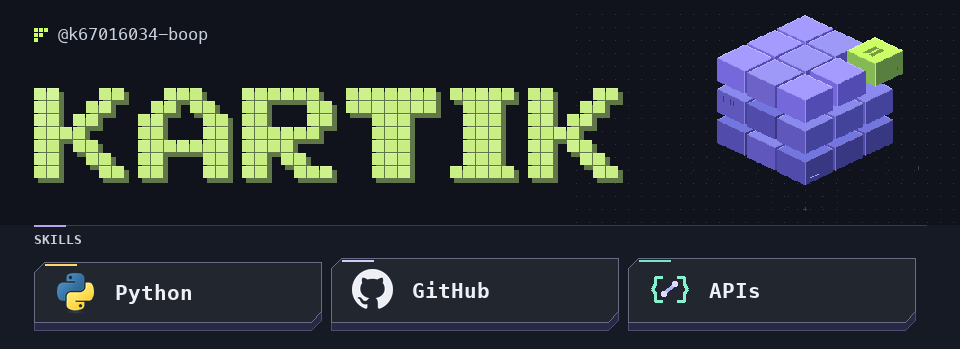
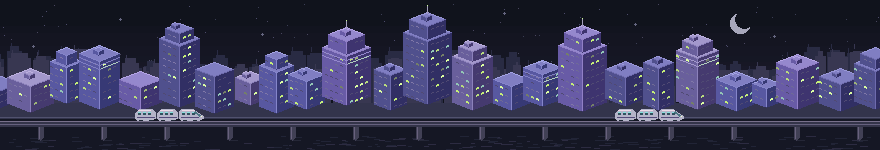
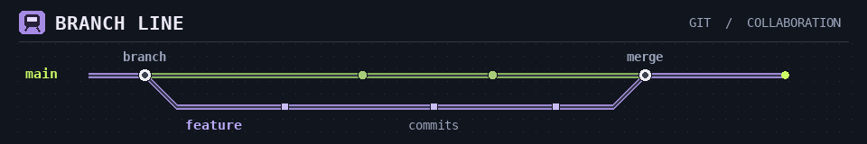

<picture>
  <source media="(max-width: 600px) and (prefers-reduced-motion: reduce)" srcset="./kartik-mobile.png">
  <source media="(prefers-reduced-motion: reduce)" srcset="./kartik-banner.png">
  <source media="(max-width: 600px)" srcset="./kartik-mobile.gif">
  
</picture>

## Midnight City

<picture>
  <source media="(prefers-reduced-motion: reduce)" srcset="./midnight-city.png">
  
</picture>

## Branch Line

<picture>
  <source media="(prefers-reduced-motion: reduce)" srcset="./branch-line.png">
  
</picture>

## Lab work

[GitHub Collaboration & API Interaction](https://github.com/k67016034-boop/cse103-lab-LAB3)
